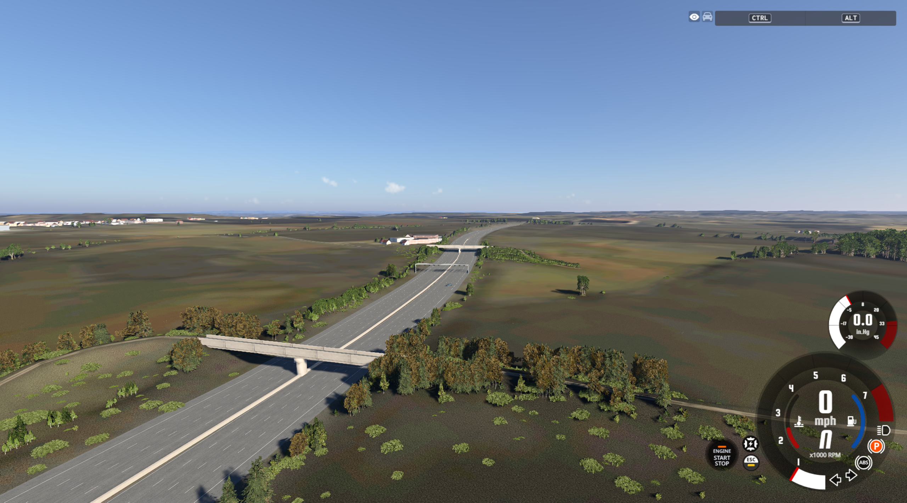

# Motorway follow-up — 22 October 2026

The fixes are shared UK generation rules. No production rule contains J26/J27 coordinates or feature IDs. The supplied real-life view is the visual reference: a continuous motorway grade beneath separate overbridges, with a central reservation.

## What changed

- **Dips:** the previous clearance solver lowered motorway carriageways to fit an underestimated overbridge height. It removed up to 5.92 m at the supplied southern location. Motorway and trunk mainlines now keep their independent road profile; secondary overbridges are raised to clear them. Mainline terrain ownership also prevents intersecting approach earthworks from deforming the carriageway.
- **Reservation:** outer shoulders now extend outward from mapped driving corridors. The road mesh, grading, bridge surfaces and AI lane centres use the same convention. Divider segments follow road/deck heights, include motorway bridge sections, meet tile boundaries, and survive different source split positions and centimetre-long reversed seams at lane-count changes.
- **Gantries:** opposite-direction camera records are deduplicated before tile ownership is decided, including across tile boundaries. Reloading neighbouring tiles cannot legitimately create two structures from that mapped pair.
- **J27:** its circulating roads are tagged `junction=circular`, including bridge sections. Closed circular junctions without explicit two-way evidence now share the UK clockwise inference used by geometry, navigation and signal placement. Explicit two-way mappings remain two-way. This distinction follows the [OSM circular-junction definition](https://wiki.openstreetmap.org/wiki/Tag%3Ajunction%3Dcircular).
- **Signals:** an existing signal head is rebuilt when its direction or model changes, even when its position is unchanged. Position-only reuse could retain an old facing direction.
- **Repeated work:** bridge profiles retain their cell cache key when looking up mainline clearance profiles. This avoids recalculating the same cell. Furniture generation remains batched; no additional per-frame lights or scripts were added.

## Verification

- 409 Python regression tests and 634 Lua assertions passed.
- Cached-data audit covers 12 M1 source sections across J26–J27. Maximum departure from the independent normal road profile is below 0.5 m, including road joins; the former multi-metre troughs are absent.
- Divider audit: 39 tiles, 987 segments, all 3,607 paired-carriageway probes within 2 m of the generated divider. The maximum is 0.985 m; this tolerance includes centre shifts at changing lane widths. It is a geometric coverage check, not a surveyed barrier-position claim.
- Four in-game collision rays at both former dip locations hit the corrected road within 4 mm of the expected road profile. These measure physical collision, not just the visible mesh.
- Live J27 graph: all 15 checked circulating links are one-way clockwise. All three linked signal heads face approaching traffic (front/incoming dot product approximately 1).
- Clean level reload and motorway screenshot checked. The player was returned to their original motorway location. Source and installed Lua copies match.

Run `tools/validate_uk_motorways.py` with the prepared UK cache to repeat the offline profile and divider audit. Results are in [uk-motorway-validation.json](uk-motorway-validation.json), with game collision/signal evidence in [uk-motorway-live-validation.json](uk-motorway-live-validation.json).

## Limits

The rules apply throughout the supported UK network; live verification covered the reported M1 corridor and J27. There is no claim that every UK crossing has been surveyed or driven. Long viaducts above 1 km retain the existing solver. Stationary frame timing included the game's FPS limiter, so no driving FPS improvement is claimed. The cached horizontal-divider audit took about 0.37 s for all 39 tiles; that is offline generation time, not in-game frame time.

This report supersedes the motorway and J27 conclusions in the earlier round-two report. Its J27 test checked nearby standard roundabouts and missed the main circular interchange; its spot grade checks missed the worst troughs.
