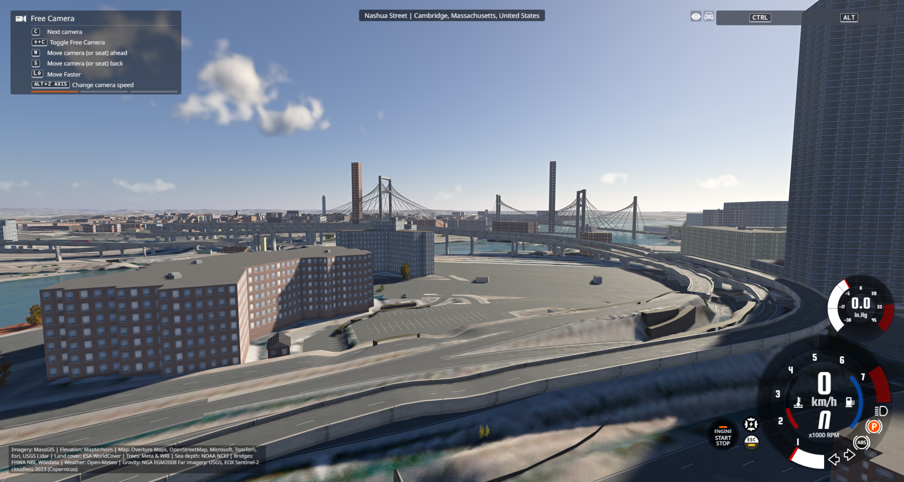
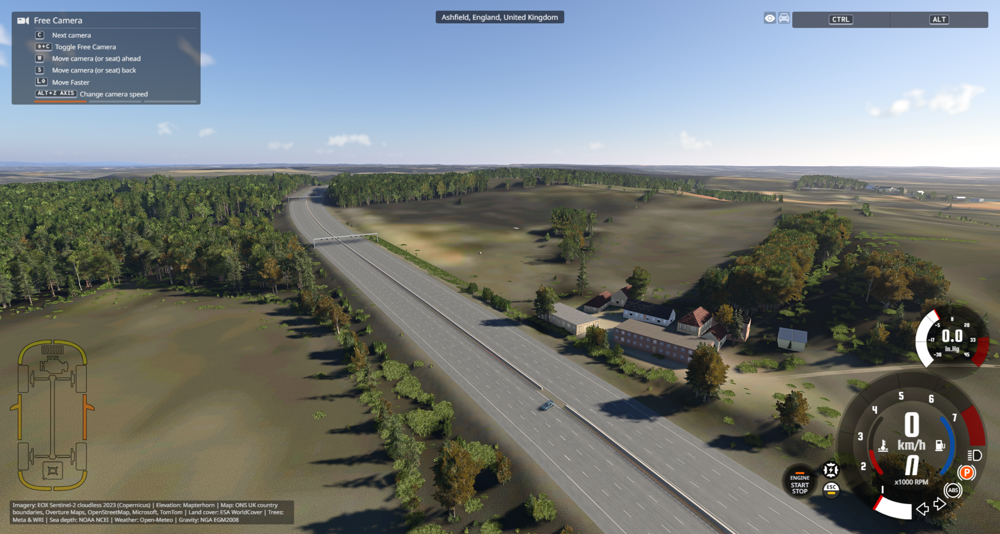
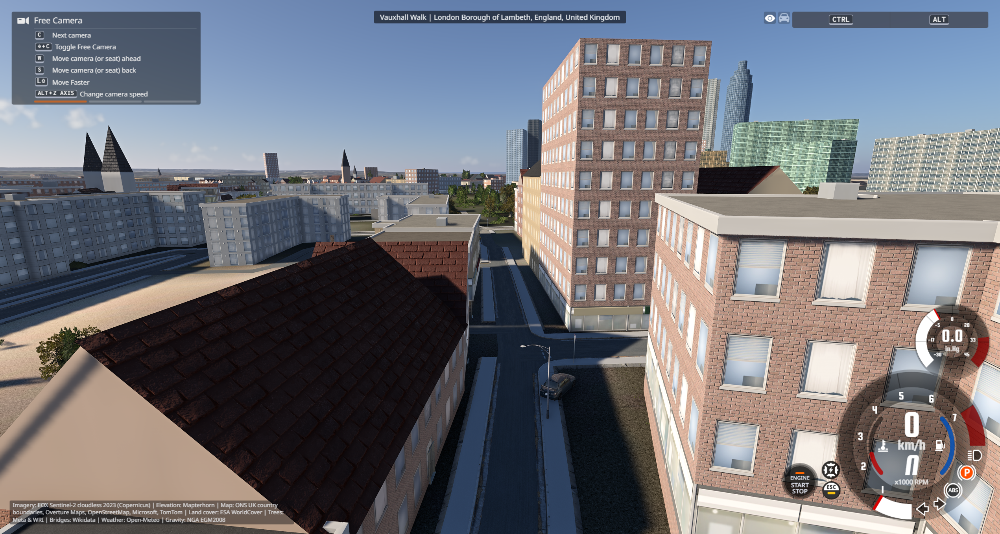
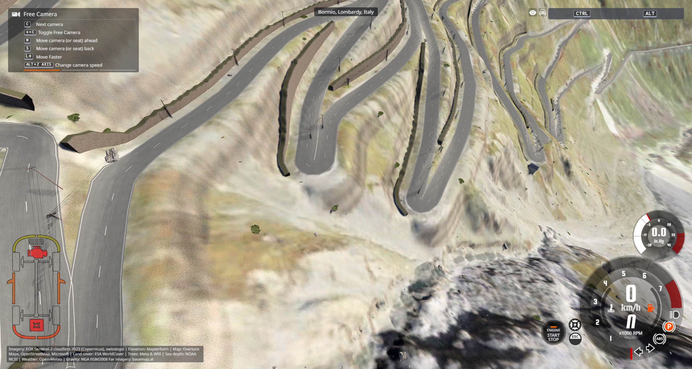

# Shared road, bridge and tunnel repairs — 22 October 2026

The Boston comparison is Leverett Circle / Nashua Street / Charles River Plaza. The supplied real-life image shows separate elevated roads, surface streets and parking, plus a route entering a tunnel. The repair keeps those routes connected through one height model, rather than estimating each mesh independently.

The production rules contain no test-site coordinates. Building footprints, positions and dimensions are unchanged by this repair.

## Boston lanes compared with the reference

- Lane counts come from aligned source road sections, including changes at merges. One- and two-lane ramps are distinct from the adjacent three-/four-lane expressway sections.
- Shoulders are separate from travel lanes in the paint and AI graph. Physical pavement width is not divided up to invent additional lanes.
- Imported widths of 30.5 m on two-lane ramps failed a lane/shoulder plausibility check. Those sections now use roughly 7.3–8.2 m, depending on road class and available shoulder data. Credible explicit widths remain authoritative; the code does not guess an undocumented unit conversion.
- The supplemental Boston extract contains 9,037 source ways. It is prepared once and read locally; driving does not trigger Overpass requests. The same attribute interpreter can use other regional extracts.
- Merge/gore paint and buildings remain procedural approximations. This is not a surveyed reproduction of every taper, sign or facade.

The source-section audit is [world-boston-lane-data.json](world-boston-lane-data.json), with extraction provenance in [world-boston-road-source.json](world-boston-road-source.json).

## Shared geometry rules

- Mapped connector identities establish which roads join. Interior routing connectors split bridge/tunnel parts. Coincident roads with different known connectors remain separate.
- Connected bridge nodes share one height. A graph-wide 8% maximum deck grade removes abrupt drops; the connected upper approaches meet the resulting abutments. Surface branches at interior bridge connectors use that same height.
- Actual crossings and centrally overlapping double decks receive clearance constraints. Slight overlap between neighbouring pavement edges does not imply another storey. Conflicting source constraints stop at the least-conflicted bounded solution instead of inflating the network on every iteration.
- UK motorway/trunk mainlines retain their independent approach trend. An underpass path's DEM sample can be the embankment above it, so it cannot force an additional motorway hill. Local abutment corrections are added to the existing road profile; they no longer replace a long rolling approach with one tangent.
- Long explicitly mapped major-road tunnels share connected floors, real external portals, cover, rendering, collision and navigation. Internal source boundaries do not create artificial entrances. Surface-road grading above a tunnel is preserved.
- Road/paving triangles follow the same two-metre terrain lattice, including the alternating diagonals. Retaining-wall volumes are checked against other road surfaces and distant sections of the same hairpin.
- Source vertical knots survive simplification. Bridge edge normals are computed before tile clipping. Large shapes retain all triangles while keeping each engine mesh at or below 60,000 vertices.

## Evidence and limits

| Check | Result |
|---|---|
| Final focused regression suite | 242 passed; see [world-focused-tests.json](world-focused-tests.json) |
| Real-data cases | All nine passed: London, Giltbrook, J26, two Boston sites, Stelvio, Sydney, Tokyo, Cape Town |
| Connected bridge junctions / road clearances | 435 junctions and 1,481 clearance constraints checked in those cases |
| Independent tile models | 20 sampled seams across Boston, J26 and Sydney agreed, maximum gap 0 m in that run |
| Boston live collision | 14/14 sampled bridge/tunnel joins hit the expected surface; maximum error 0.0134 m |
| Boston tunnel physical floor/roof | −7.3242 m / −0.4937 m at the checked point, about 6.83 m headroom |
| M1 J26–J27 divider | All 3,607 paired-carriageway probes covered across 39 tiles; maximum offset 0.985 m |
| M1 independent-profile comparison | Largest absolute difference 0.524 m, down from 18.207 m. **The existing strict 0.5 m audit still returns failure**; its threshold has not been relaxed. |

The nine-site report checks source profile fidelity, connected heights, mesh bounds/triangle retention, sampled tile seams, bounded grades and connected tunnel floors: [world-geometry-validation.json](world-geometry-validation.json). It does not mean every road in every city was driven. Some sites have no seam or road-crossing sample in the four selected tiles; their counts are explicit in the report.

The separate worker report is [world-seam-validation.json](world-seam-validation.json). It preceded the final small crossing-stability/interior-branch refinement; the final nine-site run and 242 tests include those refinements.

The M1 result is preserved verbatim in [world-m1-corridor-validation.json](world-m1-corridor-validation.json). J27's prior verification of 15 clockwise links and three correctly facing signal heads is in [uk-motorway-live-validation.json](uk-motorway-live-validation.json); J27 was not driven again in this review. This report supersedes the earlier report's claim that the current M1 comparison is below 0.5 m.

Fresh live views checked Boston's parking/loop, the M1 profile and gantry/divider, the named Vauxhall Walk road, and Stelvio's hairpins. The Thames was visible again. Giltbrook and the remaining international sites received numerical generation checks, not full live driving surveys.

Performance changes bound mesh sizes, batch terrain/paving clipping, and cache immutable source matching (16 MB per worker). No extra per-frame lighting or prop scripts were introduced. Dense cold areas still take substantial time to generate. The game's background 30 FPS limiter prevented a fair before/after driving FPS comparison, so no FPS gain is claimed.

An earlier broad Windows suite was not clean: it included platform-specific launcher/import failures, timing-sensitive tests and legacy fixture/precision assertions. The final focused 242-test run passes; the entire repository suite has not been re-certified.

Short natural arches retain the existing cover-based treatment; not every tunnel has surveyed floor/portal elevations. Water-span navigation clearance estimates remain approximate. Precise scenery, turn-lane tapers and source-data errors can still require better data.

Reproduce with `tools/validate_world_geometry.py`, `tools/validate_world_seams.py` and `tools/validate_uk_motorways.py`. The pre-review source backup is `backups/before-global-geometry-review.zip`; an additional candidate snapshot is `backups/world-candidate-before-clearance-joint.zip`.
